# Manual de usuario — Sistema de reservas Taller Bautista (V7.1)

Este manual explica el uso del sistema por rol e incluye las mejoras V7.1. Las capturas se tomaron del sistema actualizado con datos de prueba ficticios.

> Las fechas y horas del sistema siguen la hora oficial de El Salvador.

## 1. Cliente (portal público)

El cliente **no necesita cuenta**. Desde la página principal puede:
1. Ver los servicios, el horario de atención y la ubicación del taller.
2. Consultar los cupos disponibles a partir de mañana.
3. Enviar una solicitud por WhatsApp.

**Importante:** la solicitud por WhatsApp es preliminar y no reserva un cupo. El personal del taller confirma la cita y la registra en el sistema.

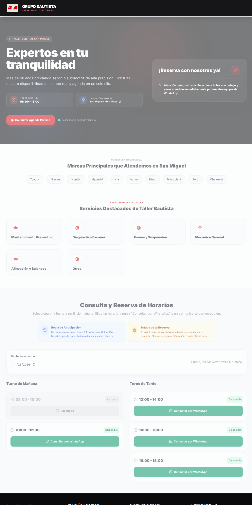

## 2. Acceso del personal

1. Abrir la opción de acceso del personal (icono de candado en el pie de página).
2. Ingresar el correo y la contraseña asignados.
3. El sistema muestra solo las pestañas que corresponden al rol del usuario.
4. Para salir, usar el botón de cerrar sesión (esquina superior derecha). Por seguridad, la sesión vence a las 8 horas.

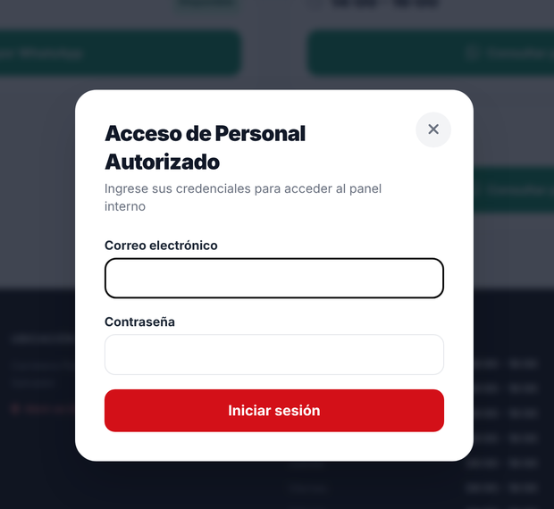

## 3. Secretaría

### 3.1 Listado de citas
Al entrar, el listado muestra las **Próximas citas (desde hoy)**, de la más cercana a la más lejana.

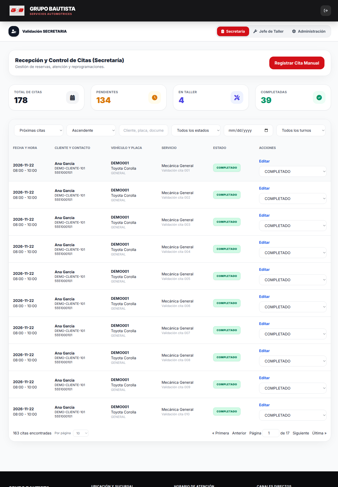

| Control | Uso |
|---|---|
| **Vista** | *Próximas citas* (desde hoy), *Historial* (anteriores a hoy, de la más reciente a la más antigua) o *Todas* |
| **Orden** (por fecha y hora) | *Ascendente* (la más próxima primero) o *Descendente* |
| Búsqueda | Por cliente, placa o documento |
| Estado / Fecha / Turno | Filtros adicionales. Con una fecha concreta, se muestran solo las citas de ese día |
| **Paginación** | « Primera, Anterior, campo **Página X de Y** (escriba un número y presione Enter), Siguiente y Última » |
| **Por página** | 10, 25, 50 o 100 citas |

El total de citas encontradas aparece debajo de la tabla. Al cambiar un filtro, el listado vuelve a la página 1.

### 3.2 Registrar una cita manual
1. Presionar **Registrar Cita Manual**.
2. Completar los datos del cliente: nombre, documento y teléfono.
3. Datos del vehículo: solo **Placa** y **Modelo** son obligatorios (\*). La **Marca** es opcional.
4. Elegir el **Servicio**. Con **Otros**, aparece el campo **“Describe el servicio requerido”**, que es obligatorio (máximo 200 caracteres).
5. Elegir la fecha y un intervalo con cupo disponible, y presionar **Confirmar registro**.

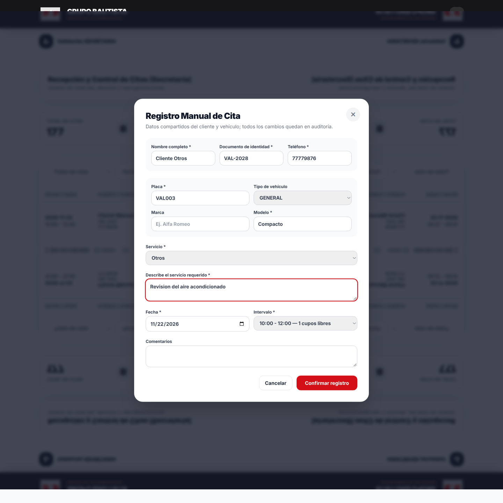

La descripción aparece junto al servicio, por ejemplo *“Otros: Revisión del aire acondicionado”*:

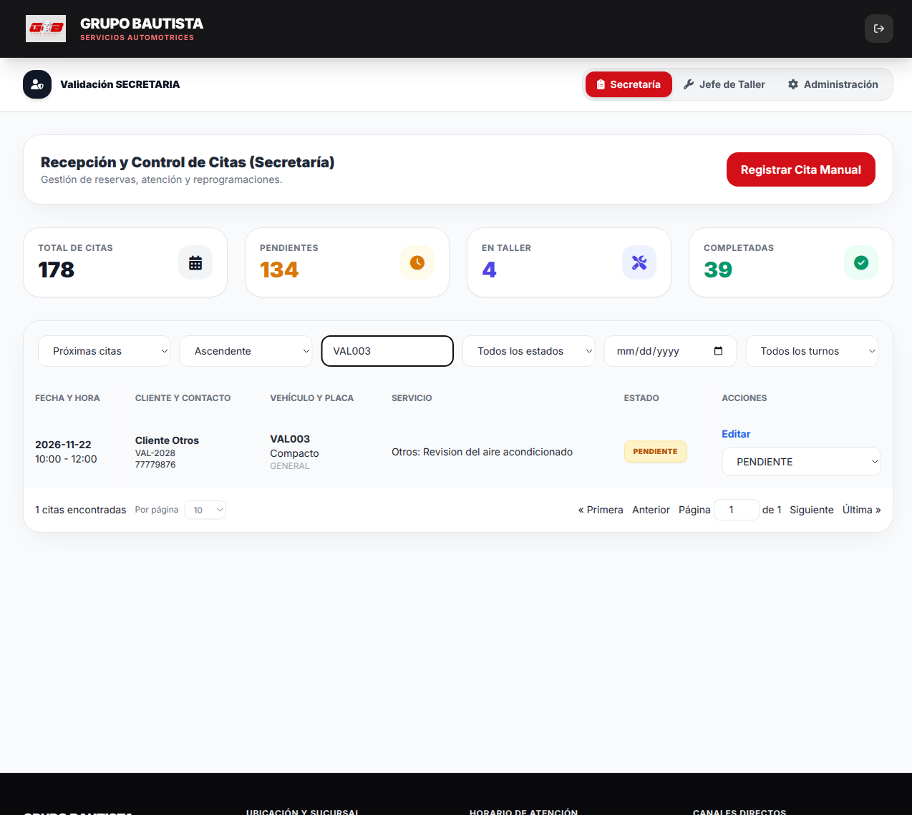

### 3.3 Editar, cancelar y reactivar
- **Editar:** abre la cita para cambiar el horario, el servicio (incluida la descripción de “Otros”) o los datos del cliente y del vehículo.
- **Estado:** el selector de cada fila permite avanzar, cancelar o reactivar la cita. Al reactivar se vuelve a comprobar que haya cupo.
- Las citas canceladas se conservan en el historial; no se eliminan.

## 4. Jefe de taller

### 4.1 Tablero (Kanban)
Al entrar, el tablero muestra las citas de **hoy**. Una línea encima de las columnas indica el período visible.

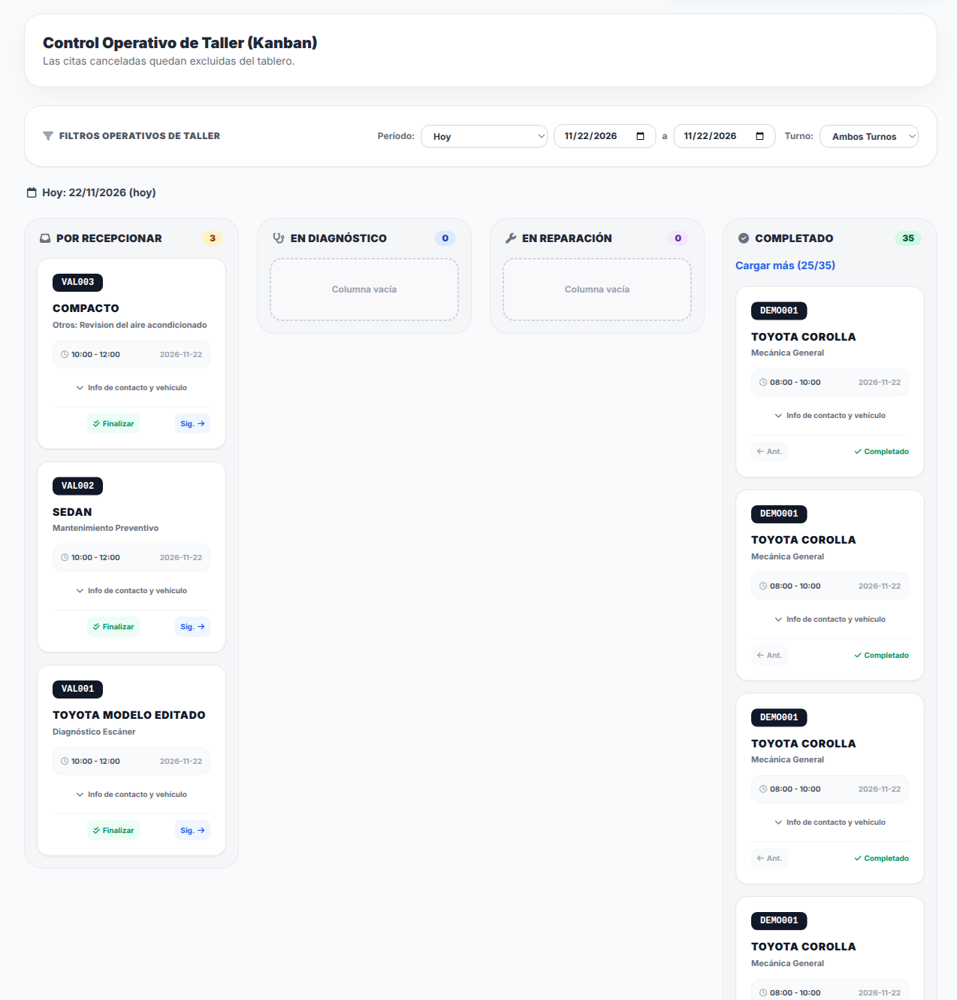

| Período | Muestra |
|---|---|
| Hoy | Citas del día actual |
| Últimos 15 días | Desde hace 14 días hasta hoy |
| Próximos 15 días | Desde hoy hasta dentro de 14 días |
| Último mes | El mes calendario anterior completo (por ejemplo, del 1 al 31 de octubre) |
| Próximo mes | El mes calendario siguiente completo (por ejemplo, del 1 al 31 de diciembre) |
| Rango personalizado | Las fechas **Desde** y **Hasta** que se elijan |

Si la fecha inicial es posterior a la final, el sistema muestra un aviso en rojo y no carga tarjetas:

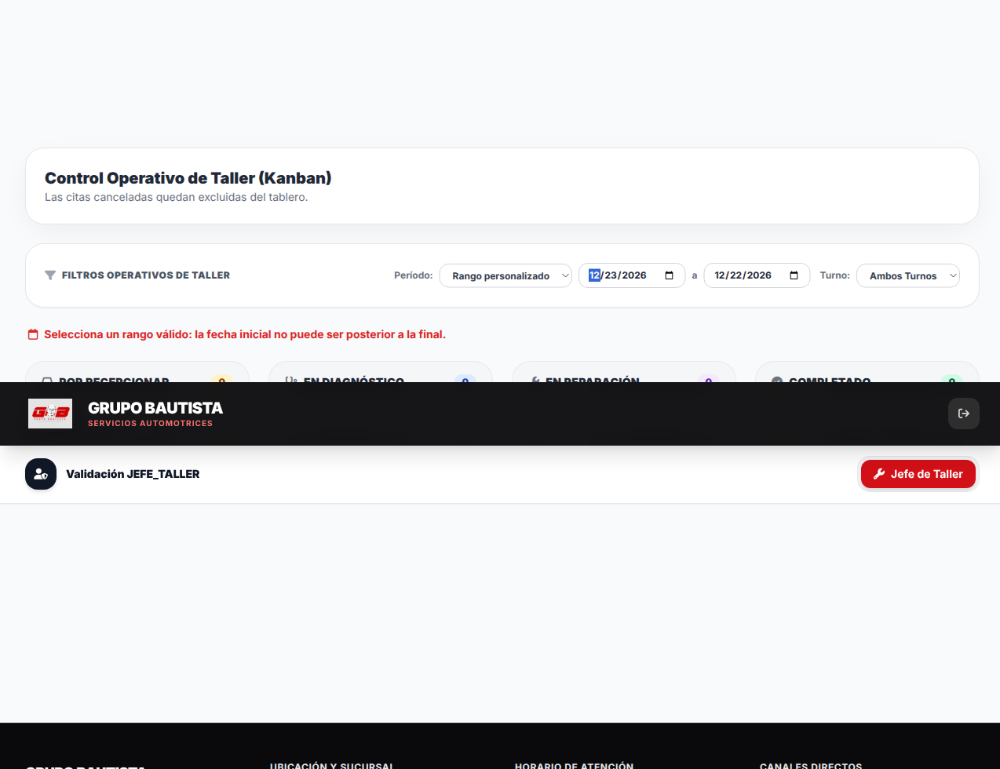

El filtro **Turno** (mañana/tarde) se combina con el período elegido. **Cargar más** muestra las tarjetas restantes de una columna.

### 4.2 Avanzar trabajos
Cada tarjeta tiene los botones **Sig.** (siguiente etapa) y **Finalizar**. Las etapas son: Por recepcionar → En diagnóstico → En reparación → Completado.

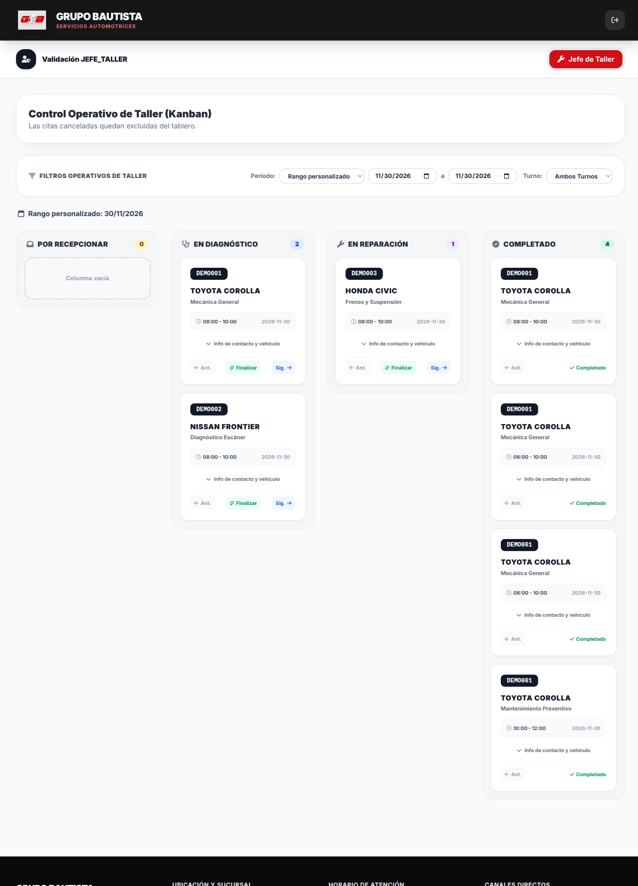

El jefe de taller **no** tiene acceso a Administración ni a la Auditoría.

## 5. Administrador / Dueño

*Secretaría también tiene acceso a este panel, según los permisos vigentes.*

### 5.1 Horarios y capacidad
Para cada día de la semana se define:
- si el taller trabaja ese día;
- la hora de apertura y la de cierre;
- los minutos por bloque;
- la capacidad.

El sistema rechaza cambios que dejarían citas activas fuera del horario o sin cupo.

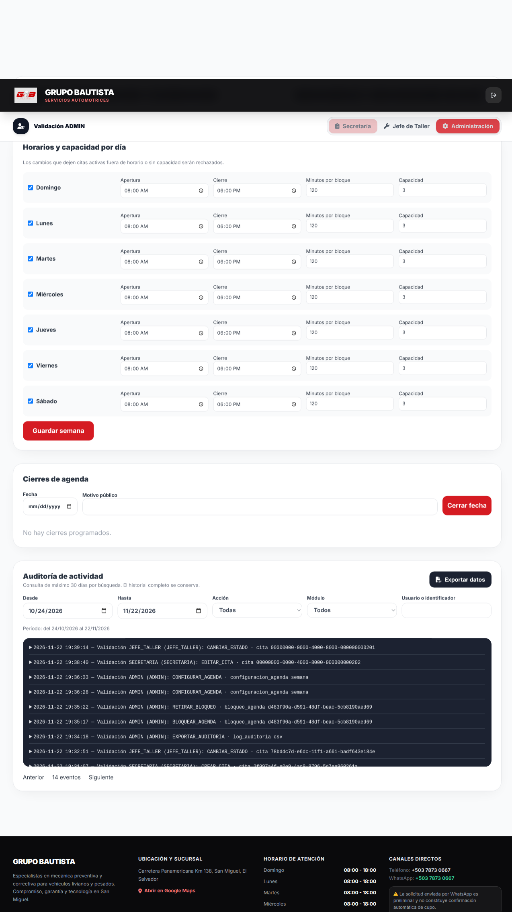

### 5.2 Cierres de agenda
Para cerrar una fecha (por ejemplo, un feriado), elegir la fecha, escribir un motivo y presionar **Cerrar fecha**. Un cierre se puede retirar más tarde.

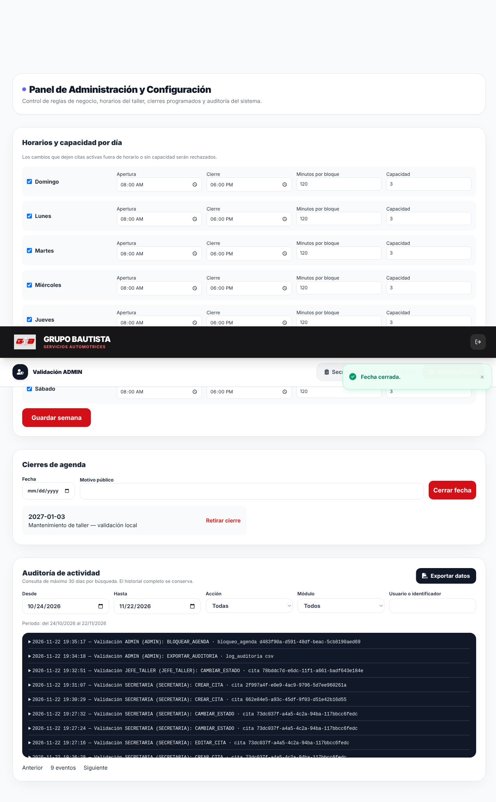

### 5.3 Auditoría de actividad
Registra quién hizo cada acción y cuándo. Los registros no se pueden modificar ni borrar.

1. Por defecto se muestran los **últimos 30 días**.
2. Cada consulta puede abarcar **como máximo 30 días**. Si el rango es mayor, aparece un aviso y se desactiva la exportación. El historial completo se conserva: basta con consultar otro período.
3. Filtros disponibles: **Acción** (por ejemplo, CREAR_CITA), **Módulo** (por ejemplo, cita) y **Usuario o identificador**.
4. **Exportar datos** descarga un archivo CSV (se abre en Excel) con **todos** los registros del filtro, no solo los de la página visible. El archivo no incluye contraseñas, tokens ni otros datos sensibles.
5. Cada exportación también queda registrada en la auditoría.

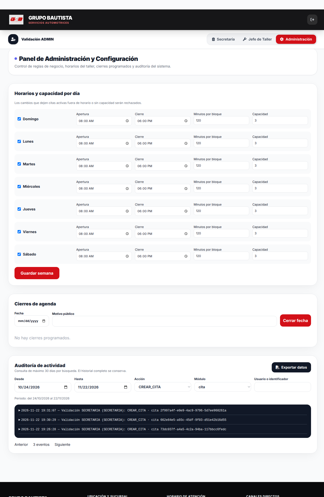

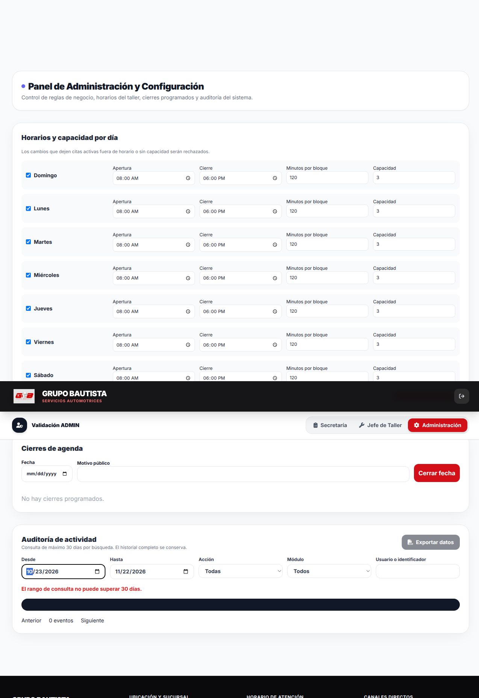

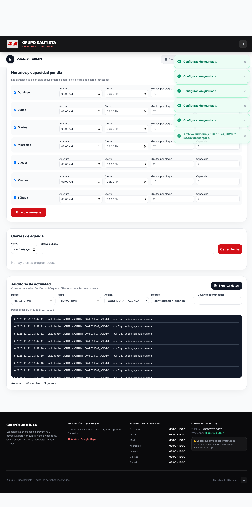

## 6. Preguntas frecuentes

- **¿Por qué no veo citas pasadas en Secretaría?** La vista inicial muestra las próximas citas. Elija *Historial* o *Todas*.
- **¿Puedo registrar un vehículo sin marca?** Sí. Solo la placa y el modelo son obligatorios.
- **¿Cómo consulto la auditoría de hace dos meses?** Elija un rango de hasta 30 días dentro de ese período.
- **¿El jefe de taller ve todas las fechas?** Abre en *Hoy*. Use el selector de período para ver otras fechas.
